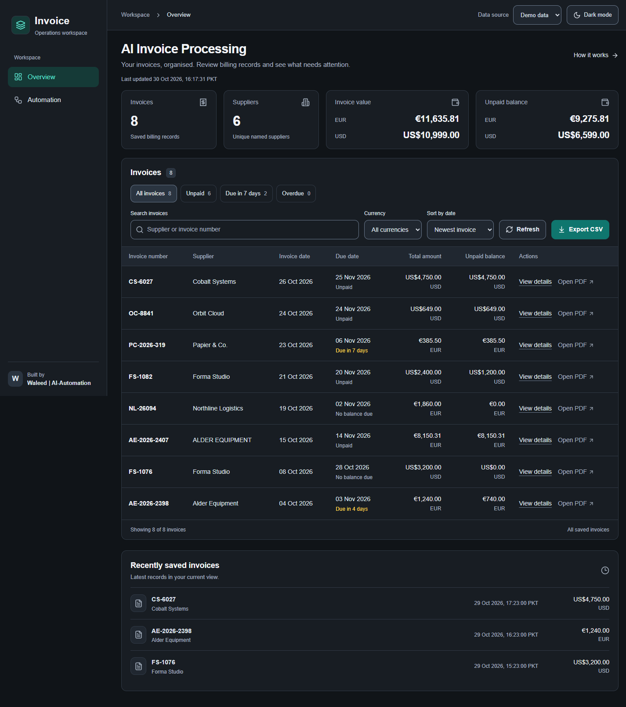
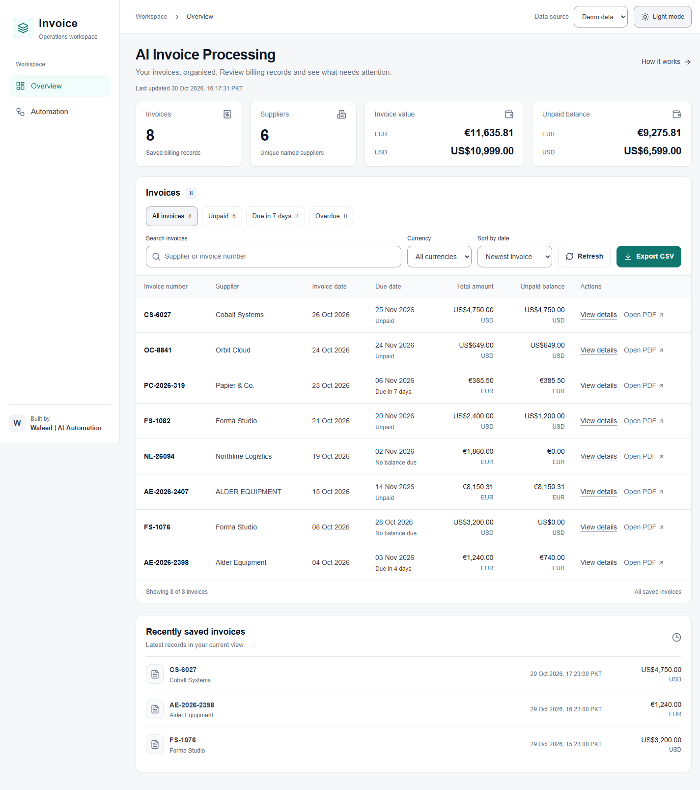

# AI Invoice Processing & Dashboard

**AI-assisted invoice extraction, duplicate checks, and organised billing records.**

An n8n workflow reads invoice PDFs from Google Drive, extracts their key fields with a Groq-hosted language model, checks for existing records, and saves new invoices to Google Sheets before notifying the billing team by email. A Next.js dashboard demonstrates how those records can be reviewed in a clear financial workspace.

**Built by Waleed | AI-Automation**

## What it solves

Invoice details often need to be copied from documents into a billing sheet. Repeated submissions can create duplicate records, while the original PDF becomes difficult to find. This project connects document intake, extraction, a duplicate lookup, and email notification in one workflow.

The dashboard provides a sample-data interface for browsing invoices, finding upcoming due dates, and reviewing amounts in their original currencies.

## Features

### Invoice automation

- Watches a selected Google Drive folder for newly created files.
- Downloads invoice PDFs and extracts their embedded text.
- Extracts supplier details, invoice identifiers, dates, amounts, and currency.
- Checks for an existing row using invoice number, supplier name, and currency.
- Skips a matching invoice; appends a new invoice to Google Sheets.
- Stores the original file URL and processing timestamp.
- Generates a concise notification email and sends it through Gmail.
- Exposes an invoice-list webhook protected by an X-API-Key header.

### Dashboard demonstration

- Invoice and supplier summaries.
- Invoice value and unpaid balance grouped by currency.
- Search, currency filtering, and date sorting.
- All invoices, unpaid, due in seven days, and overdue views.
- Invoice details and source-document links when available.
- CSV export of the filtered records and refresh controls.
- A secure server-side n8n proxy; its API key is never exposed to the browser.
- Light and dark themes with a labelled toggle, saved preferences, a light first-visit default, and safe handling of blocked browser storage.
- Author branding and a separate automation overview.

**Demo scope:** the dashboard uses fictional records. The n8n endpoint was tested independently, but the final dashboard has not been connected to live data for this portfolio demonstration. Demo figures and due labels are illustrative, not business performance results. Opening a source PDF requires a valid configured link and suitable Drive permissions.

## Workflow

~~~mermaid
flowchart TD
    A[New file in Google Drive] --> B[Download PDF and extract text]
    B --> C[Extract invoice fields]
    C --> D[Look up invoice in Google Sheets]
    D --> E{Matching record?}
    E -->|Yes| F[Skip duplicate]
    E -->|No| G[Save invoice and source link]
    G --> H[Generate notification and send email]
~~~

A separate GET webhook reads sheet rows and responds with an invoices array. The dashboard demonstration can be explored without running this branch.

## Technology

| Layer | Tools |
| --- | --- |
| Automation | n8n |
| Document intake | Google Drive |
| Extraction and email drafting | Groq chat models |
| Ledger | Google Sheets |
| Notifications | Gmail |
| Dashboard | Next.js, React, TypeScript, Tailwind CSS |

## Screenshots

### Light theme

[Mobile light theme](docs/screenshots/dashboard-mobile-light.png) | [Mobile dark theme](docs/screenshots/dashboard-mobile-dark.png)

The screenshots show the integrated application using fictional sample data, captured during repository verification. They are not a live client workspace.

## Repository structure

~~~text
dashboard/                    Finished Next.js app, lockfile, tests and configuration
  .env.example                Optional live connection and upload-folder settings
workflows/
  invoice-processing.json     Sanitised importable n8n workflow
docs/
  setup.md
  architecture.md
  data-contract.md
  verification.md
  workflow-export-notes.md
  screenshots/
examples/
  invoices/                   Fictional PDFs, including a duplicate fixture
  expected-core-fields.json
  api/invoices.example.json
  sheets/invoice-ledger-template.csv
~~~

## Run the dashboard

~~~bash
cd dashboard
npm ci
npm run dev
~~~

Use the URL printed by the development server and choose Demo data. This mode does not require Google credentials or a Groq API key. The included npm lockfile pins the application dependencies. Node.js 20.9 or newer is required.

See [setup instructions](docs/setup.md) for the workflow and optional API configuration.

## Application checks

Run from `dashboard/`:

~~~bash
npm run lint
npm run typecheck
npm test
npm run build
~~~

See [verification notes](docs/verification.md) for the executed checks and environment limitations.

## Sample invoices

Seven fictional PDFs are included: six distinct invoices across PKR, USD, GBP, EUR, and AED, plus a duplicate of the Cedar IT invoice. Some invoices have multiple pages or discount/shipping fields.

Upload 01_cedar_it_pkr.pdf first and 07_cedar_it_duplicate.pdf afterwards to exercise the duplicate branch. The expected result is one Cedar invoice row, not two. See [fixture notes](examples/README.md).

## Implementation details and limits

- This workflow extracts embedded PDF text. Scanned/image-only documents need a separate OCR step.
- The current schema captures invoice-level fields, not line items or tax components.
- Duplicate detection is an exact field lookup, not a transactional uniqueness constraint. Formatting differences or simultaneous executions can bypass it.
- Invoice arithmetic checks, approvals/rejections, and payment reconciliation are outside the current implementation.
- Due statuses and calculated balances reflect recorded data, not verified bank payments.
- Extraction can be incomplete or incorrect. Review financial records before using them operationally.
- An email failure occurs after the sheet append; there is no separate delivery/retry ledger.
- Imported workflows need account credentials, resource IDs, and a real notification recipient.
- The dashboard has no user sign-in layer; protect access before exposing live financial records.
- The PDF fixtures, API example and dashboard demo records are separate synthetic datasets.
- Sanitisation and JSON checks are not a runtime test of the imported workflow.

See [verification notes](docs/verification.md) for the evidence and remaining checks.

## Author

**Waleed Shehzad — Waleed | AI-Automation**

[Portfolio](https://www.waleed-shehzad.me/) · [GitHub](https://github.com/Waleed-Shehzad)
